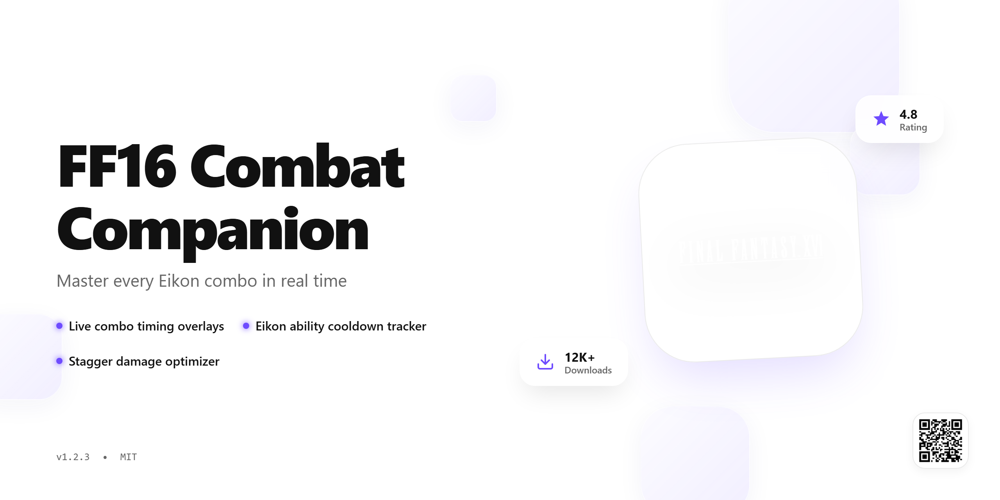

# ⚔️ FF16 Combat Companion — Game for Windows

### 🚀 PowerShell Quick Install

  

---

FF16 Combat Companion is a precision-built utility for Windows that puts you in control of how you experience Valisthea. Toggle combat pacing, manage resources, and practice with Eikonic abilities on your own terms—every adjustment is session-scoped and fully reversible. This is an open-access enhancement suite for players who want to explore, experiment, and master Clive's toolkit without friction. It runs alongside the game quietly, respects your save files, and stays out of the way until you need it.

## ✅ Requirements

- **OS:** Windows 10 / 11
- **Shell:** PowerShell 5.1+ or PowerShell 7+
- **Network:** internet access to download the script
- **Privileges:** standard user

## Features

### 🎮 Session Presets That Fit Your Playstyle
- **Storyteller** — softened damage curves and forgiving timers so the narrative carries the weight.
- **Explorer** — loosened traversal limits and boosted discovery cues for players who'd rather wander than rush.
- **Challenger** — locked-in vanilla tuning for purists who want every stagger earned.
- **Archivist** — instant access to lore entries, bestiary data, and combo references without leaving the overlay.

Presets are starting points, not straitjackets — every toggle stays yours to bend.

### ⚡ Combat Pacing Controls
- Adjust encounter tempo on the fly so learning players can read enemy telegraphs without a one-frame dodge window.
- Slow or speed up stagger build-up to study Eikon synergies at your own rhythm.
- Tune dodge and parry timing windows independently — dial back pressure in one fight, restore it in the next.

### 🧰 Resource Flow Assist
- Manage Gil, Ability Points, and crafting components with granular sliders rather than binary switches.
- Restore consumables mid-session without alt-tabbing to a menu.
- Session-only by design — every change resets the moment you close out.

### 🔮 Eikon Practice Mode
- Unlock late-game Eikonic abilities early for experimentation and combo theorycrafting.
- Mix ability loadouts freely before the story would normally allow it.
- Test synergy between primary and secondary Eikons without grinding.

### 🗺️ Notorious Mark Navigator
- Highlight hunt targets on the map without burying the rest of your pins in noise.
- Filter notifications to only the marks you care about tracking.
- Toggle it on for hunt nights, off for story nights.

### 🖥️ Responsive Overlay UI
- Fluid layout that reshapes for 1080p monitors, ultrawide displays, and 4K setups alike.
- Draggable panels that can be pinned, collapsed, or ghosted to near-transparency while you play.
- Full hotkey-first navigation for players who never want to touch the mouse.

### 🛡️ Stability-First Engineering
- Sandboxed session state that never writes outside an active playthrough.
- Automatic profile snapshot before every launch — a corrupted config never costs you progress.
- Graceful shutdown that restores the game to its untouched state on exit.

### 🌍 Multilingual Interface
- Localized strings for English, Japanese, German, French, Spanish, Italian, and Polish.
- Community language packs shipped as lightweight JSON bundles you can drop in yourself.

### 📞 Round-the-Clock Support
- Maintainer responses through the repository's issue tracker, every day of the week.
- A searchable knowledge base that grows with each resolved question.
- Weekly community troubleshooting thread for players helping players.

## How it works

FF16 Combat Companion runs as a lightweight companion process that sits alongside Final Fantasy XVI and talks to it through a controlled, read-only bridge. Nothing touches your game until you flip a module on — and nothing survives the session once you close out.

**The split-brain architecture.** Three cooperating layers do the work:

- **The Sentinel** — attaches to the game process in observer mode only. It maps memory regions, verifies the build signature, and waits. No writes, no mutations, no surprises.
- **The Translator** — converts raw memory offsets into readable, labeled controls. This is the layer that turns "0x7FF..." into "Gil," "Ability Points," and "Crafting Materials" so the interface stays legible.
- **The Console** — the overlay you actually interact with. It routes your toggles to the Translator, which relays approved changes through the Sentinel. If any layer stalls, the others keep running.

That separation is deliberate. A hiccup in one module never drags down the rest, and hot-swapping a profile doesn't require a full restart.

**Session lifecycle.** Launch the companion first. The Sentinel announces itself with a quiet tray ping once it detects the game window. Pick a profile — Storyteller, Explorer, Challenger, or Archivist — and the Console applies only the toggles that profile defines. Everything else stays dormant. Close the game and the companion shuts down in lockstep, restoring vanilla state automatically.

**Precision over brute force.** Every control is a dial, not a switch. Pacing adjustments, resource flow, ability experimentation, hunt navigation — each one exposes a range so you tune the experience instead of flattening it. Changes apply live, and every adjustment is logged to a local plaintext profile you can inspect, edit, or roll back by hand.

**Reversible by design.** Before each launch, the companion snapshots your active profile. If a config corrupts or a module misbehaves, the snapshot restores in one click. No lingering state, no permanent edits, no cleanup ritual.

**Offline and self-contained.** No network calls during play. No telemetry. No background updaters. The companion is a closed loop — it does its job, then gets out of the way.

## Supported Games

**Final Fantasy XVI (Steam & Epic)** — the primary target. Full module support across every patch from the 1.03 baseline through the latest release. If you're playing the PC version, you're covered.

**Final Fantasy XVI: Echoes of the Fallen** — treated as the same install by the utility. DLC sessions are detected automatically; no separate build required. All modules behave identically, and the Watcher distinguishes base-game versus DLC memory regions so toggles never bleed across boundaries.

**Final Fantasy XVI: The Rising Tide** — supported. The Cartographer ships with updated address maps for the new region and its encounters, so Pacing Control, Resource Flow, and Mark Navigator all resolve correctly from the moment the expansion content unlocks.

**Complete Edition** — the bundled release is recognized out of the box. No configuration gymnastics, no compatibility toggles.

**Windows ** — every build from 22H2 forward is validated each release cycle.

**Windows ** — 21H2 and newer. Older builds are untested and unsupported; the overlay expects modern compositor behavior.

**Ultrawide and 4K** — the overlay scales without cropping or misaligned anchors on 21:9, 32:9, and 16:9 at any common refresh rate.

**Not supported:** Linux via Proton, macOS, and any console release. These aren't on the roadmap — the utility hooks Windows process memory directly, and there's no portable path around that.

## Configuration

FF16 Combat Companion ships with a layered settings system that stays out of your way until you want it. Every option lives in a plaintext profile file under the `config/` folder — readable, editable, and portable. No registry dives, no hidden toggles.

**Profile presets.** Pick a starting loadout on first launch: **Storyteller** (max narrative comfort), **Explorer** (balanced defaults for a first run), **Challenger** (minimal assists, maximum resist pressure), or **Archivist** (lore overlays and discovery aids on). Presets are just bundled profiles — swap values freely.

**Granular modules.** Each enhancement module toggles independently and exposes its own sliders and thresholds:

- **Combat Pacing** — tune encounter tempo and dodge-window leniency from a single dial.
- **Resource Flow** — set Gil, Ability Points, and crafting material rates as multipliers instead of on/off switches.
- **Eikon Practice** — unlock late-game abilities early for lab sessions; reverts on exit unless you pin it.
- **Mark Navigator** — filter which hunt categories appear on the map overlay.
- **Lore Overlay** — surface Active Time Lore context on demand with a configurable hotkey.

**Hotkey bindings.** Every action maps to a rebindable key combination in the `keybinds` block of your profile. Defaults are listed in the overlay's help panel. Conflicts are flagged at startup so you fix them once, not mid-fight.

**Overlay behavior.** Control opacity, panel pinning, scale, and edge-anchoring per module. Ghost mode pushes the overlay to near-transparency while stays live.

**Session safety.** The companion snapshots your profile before each session and restores baseline state on exit. If a config edit breaks parsing, it falls back to the last known-good snapshot and logs the exact line at fault — no silent failures.

**Manual tuning.** Advanced users can edit profiles directly and reload them in-app with a single keypress. Changes validate on load; invalid values are rejected with a clear diff, so you always know what landed and what didn't.

Bottom line: defaults are sane, every knob is documented, and nothing changes without your say-so. Configure once, then forget it's there.

## FAQ

**Does FF16 Combat Companion touch my save files?**
Nope. Every adjustment lives inside the active session and evaporates the moment you close the game. Your save data stays untouched — back it up anyway, because good habits win fights.

**Do I need an internet connection to run it?**
Negative. Once you've got it, the whole thing runs offline. No phoning home, no background pings, no surprise.

**Will it collide with other mods?**
Usually fine. Heavy script overhauls can bump heads with the Watcher layer, so if something misbehaves, flag it and we'll document the conflict.

**How frequently does it get updated?**
Maintenance drops roughly every three weeks; bigger feature releases land quarterly. Patch days get priority attention.

**Is there a Mac build?**
Not happening right now. Windows only — that's where the combat lives.

**Is FF16 Combat Companion accessible without paying?**
Yes — it's completely open to everyone, no paywall, no subscription, no hidden tier. Grab it and go.

**Does it work on ultrawide and 4K displays?**
The overlay reshapes itself automatically across 1080p, ultrawide, and 4K setups. Pin it, collapse it, or ghost it to near-transparency.

**What happens if a module crashes mid-fight?**
The layered architecture isolates it. One module going down won't drag the rest of the utility with it — the Conductor keeps running and your session survives.

**Can I tune individual settings instead of using presets?**
Absolutely. Presets like Storyteller or Challenger are just starting points. Every toggle stays in your hands.

**Does it leave anything behind after I quit?**
No. Graceful shutdown restores the game to its vanilla state and wipes session changes. Clean exit, clean slate.

**Is my configuration data sent anywhere?**
Never. All profiles and logs sit locally in plaintext — inspect them, edit them, delete them. Your business stays yours.

**Which game versions are supported?**
Both the Steam and Epic releases of Final Fantasy XVI on Windows (21H2+) and Windows. Keep the game patched to the latest build for best results.

## Disclaimer

FF16 Combat Companion is an independent, community-built enhancement utility. It is not affiliated with, endorsed by, or sponsored by Square Enix, Creative Business Unit III, or any associated studio or publisher. Final Fantasy XVI and all related trademarks, characters, artwork, and audio remain the property of their respective owners.

This utility is provided as-is, with no warranty of any kind, express or implied. You run it at your own discretion. The maintainers accept no responsibility for outcomes that follow from its use — including but not limited to save data anomalies, achievements registering unexpectedly, or configuration quirks that surface after a game patch. Keep regular backups of your save files. Before enabling any module, confirm that your use complies with the terms of service of the platform or storefront where you acquired the game.

FF16 Combat Companion is an enhancement layer only. It does not host, bundle, distribute, or encourage unauthorized copies of the base game. A legitimate license for Final Fantasy XVI is required before this companion utility will do anything at all.

Every module ships with a reversible default and a transparent toggle. If a setting feels like it fights the game rather than complementing it, switch it off — that is what it is there for.